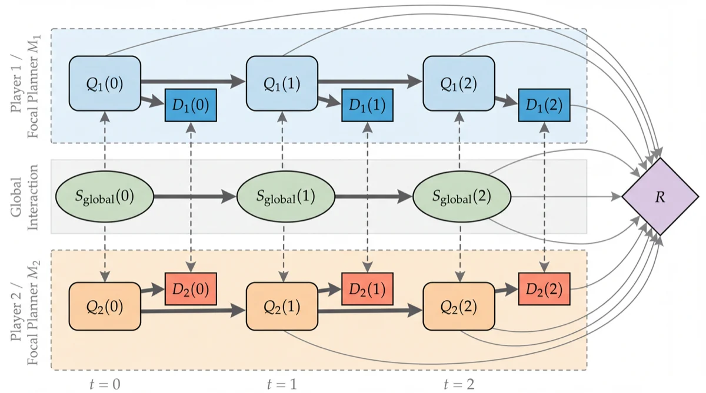
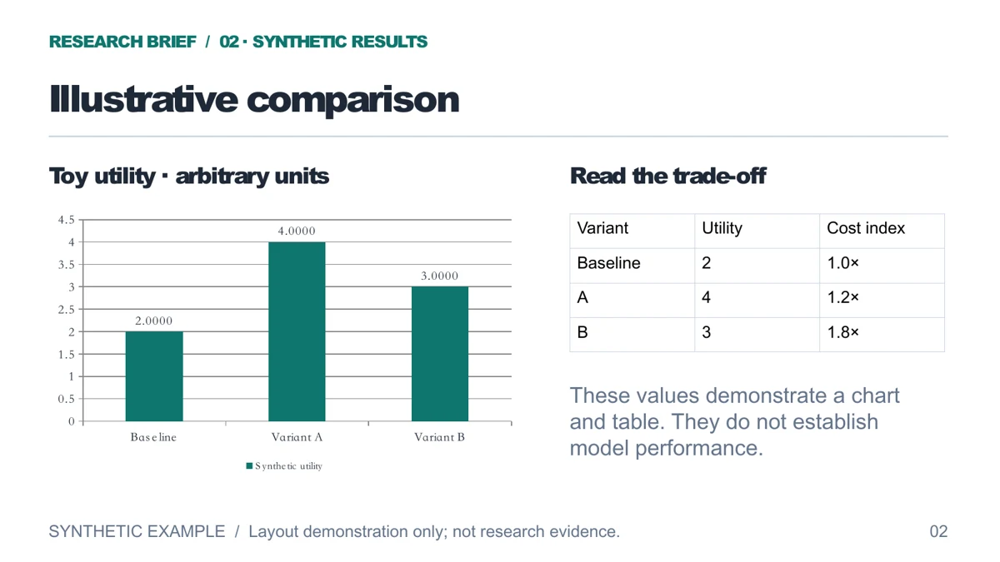
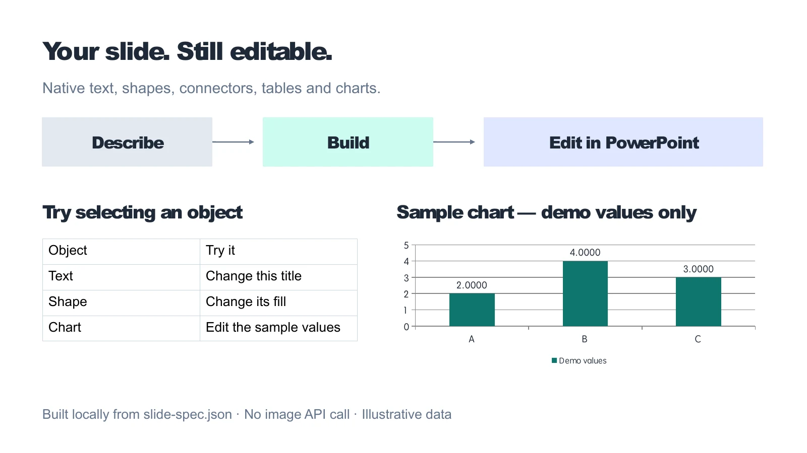

# PaperBanana Skills

> Preview branch: marketplace 4.6.0, figure plugin 4.5.0, deck plugin 1.4.0. The v4.5 release remains the stable baseline. See [native/API routing](references/image-routing.md); native generation requires no Python backend.

**Academic figures and editable slide decks, from your agent.**

[](https://github.com/PlutoLei/paperbanana-skill/releases)
[](https://github.com/PlutoLei/paperbanana-skill/actions/workflows/validate.yml)
[](LICENSE)

**English** · [中文](README_CN.md)

[Get started](#quick-start) · [Download editable PPTX](examples/editable-demo/research-brief/research-brief.pptx) · [Examples](#selected-examples) · [Documentation](#documentation)

Turn a methods description into a scientific figure, build a consistent image deck, or create PowerPoint objects you can edit. Use the skills in **Codex or Claude Code**.

<p align="center">
<a href="docs/gallery.md#academic-figures--学术插图"></a>
<a href="docs/gallery.md#slide-deck"></a>
<a href="examples/editable-demo/research-brief/README.md"></a>
</p>

<p align="center"><strong>Scientific figures · Image slide decks · Editable PowerPoint</strong></p>

*The first two previews are archived outputs; the third is a local rendering with synthetic data. [Sources and full-resolution examples →](docs/gallery.md)*

## Quick start

### 1. Choose your output

| Output | What you need |
| --- | --- |
| **Scientific figure** | `paperbanana` + the [Python backend](docs/getting-started.md#python-backend), with image and review providers configured |
| **Image slide deck** | `paperbanana-slide-deck` + the same backend; full-slide artwork is delivered as images |
| **Editable PowerPoint** | `paperbanana-slide-deck` + Bun; [build the included example](examples/editable-demo/research-brief/README.md) locally, with no image API call |

### 2. Install for your agent

**Codex** — install the figure skill from its complete bundle:

```bash
npx skills add https://github.com/PlutoLei/paperbanana-skill/tree/master/plugins/paperbanana/skills/paperbanana -a codex
```

For either deck mode, use the separate [deck skill installation](docs/getting-started.md#codex). Installing a skill does not install Bun, configure image access or install the Python backend.

**Claude Code** — add the marketplace, then choose the [figure or deck plugin](docs/getting-started.md#claude-code):

```bash
claude plugin marketplace add PlutoLei/paperbanana-skill
```

### 3. Describe the task

> Use paperbanana with Gemini to draw a four-layer CNN with batch normalization. Label the input, convolution blocks and classifier; return the image and its review status.

For an editable deck, specify **native editable PPTX objects**. For image slides, specify **image mode**. Keep your preferred provider explicit. [Starter prompts →](docs/prompts.md)

Existing Gemini / Vertex users can keep their configuration. **Preview only:** Codex native image routing and Image 2.5 controls remain on [`codex/image25-adapter`](https://github.com/PlutoLei/paperbanana-skill/tree/codex/image25-adapter), outside the current v4.5 release. [Provider roles and preview setup →](docs/providers.md)

## Selected examples

<table>
<tr>
<td width="50%" valign="top"><strong>Scientific figure</strong><br/><a href="examples/game_theory_influence_diagram.png"></a><br/>Archived Gemini output · <a href="docs/prompts.md#scientific-figure">Starter prompt</a></td>
<td width="50%" valign="top"><strong>Image slide deck</strong><br/><a href="docs/gallery.md#slide-deck"></a><br/><a href="docs/gallery.md#slide-deck">View the set</a> · <a href="docs/prompts.md#consistent-deck">Starter prompt</a></td>
</tr>
<tr>
<td width="50%" valign="top"><strong>Editable research brief</strong><br/><a href="examples/editable-demo/research-brief/README.md"></a><br/>3 slides · Synthetic data · <a href="examples/editable-demo/research-brief/research-brief.pptx">Download PPTX</a> · <a href="examples/editable-demo/research-brief/slide-spec.json">Source spec</a></td>
<td width="50%" valign="top"><strong>Minimal editable example</strong><br/><a href="examples/editable-demo/README.md"></a><br/>1 slide · <a href="examples/editable-demo/editable-demo.pptx">Download PPTX</a> · <a href="examples/editable-demo/slide-spec.json">Source spec</a></td>
</tr>
</table>

Archived images are preserved with their provenance limits. Both PPTX examples can be rebuilt locally; their values demonstrate editability and are not research results. Starter prompts are new recipes, not recovered historical inputs. [Full gallery →](docs/gallery.md)

## How it works

- **`paperbanana`** guides figure, plot and slide requests through the configured Python pipeline: retrieval, planning, styling, generation and Critic review.
- **`paperbanana-slide-deck`** plans a deck and coordinates its content and visual style. Choose image slides or native editable PPTX objects explicitly.
- **[Python backend](https://github.com/PlutoLei/paperbanana)** supplies model integrations and the generation/review pipeline. The local editable renderer lives in this repository.

The host, image provider and review provider have separate roles. A VLM integration does not necessarily generate images. [Providers, runtime support and routing →](docs/providers.md)

## Validation and limits

CI checks the skills, manifests and PPTX renderer. The [editable research brief](examples/editable-demo/research-brief/README.md) includes a source spec and native objects. Its previews were inspected after local rendering; they do not establish identical rendering in every PowerPoint version. Review generated labels, arrows, numbers and scientific claims before publication; a Critic score is an automated opinion, not scientific acceptance.

Image outputs can contain text or diagram errors. If review fails, describe the result as **unreviewed**. Historical comparisons and recent smoke tests do not establish a universal model ranking, fixed generation time or cost. [Evidence and review guide →](docs/evaluation.md)

## Documentation

| Guide | Use it for |
| --- | --- |
| [Getting started](docs/getting-started.md) | Installation, Python setup and first output |
| [Gallery](docs/gallery.md) · [Starter prompts](docs/prompts.md) | Outputs, full-resolution files and task recipes |
| [Providers](docs/providers.md) | Claude Code / Codex, Gemini / Vertex, OpenAI and preview features |
| [Styles](docs/styles.md) | Bundled styles, optional libraries and backend presets |
| [Editable PPTX examples](examples/editable-demo/research-brief/README.md) · [Spec reference](plugins/paperbanana-slide-deck/references/editable-slide-spec.md) | Build and edit native PowerPoint objects |
| [Commands and troubleshooting](docs/usage.md) | Common commands, recovery and review status |
| [Evaluation](docs/evaluation.md) | Evidence, quality checks and limitations |
| [Changelog](CHANGELOG.md) · [Releases](https://github.com/PlutoLei/paperbanana-skill/releases) | Version history |

Current release components: marketplace **4.5.0**, `paperbanana` **4.4.0**, `paperbanana-slide-deck` **1.3.0**. These are separate component versions.

## Contributing and attribution

See the [contributing guide](CONTRIBUTING.md) and [code of conduct](CODE_OF_CONDUCT.md). Describe the runtime, provider/model and reproducible steps when reporting an issue.

Built on the [PaperBanana project](https://github.com/llmsresearch/paperbanana), with additional integrations in the [maintained Python fork](https://github.com/PlutoLei/paperbanana). See [style sources](docs/styles.md) for the preset libraries.

[MIT](LICENSE) · Maintained by [Lei Yuxuan](https://github.com/PlutoLei).
