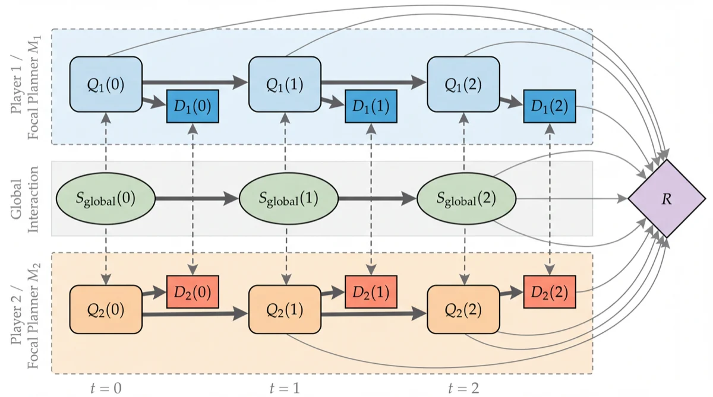
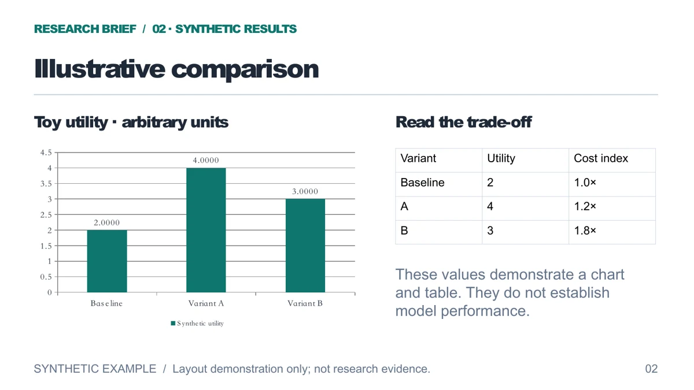
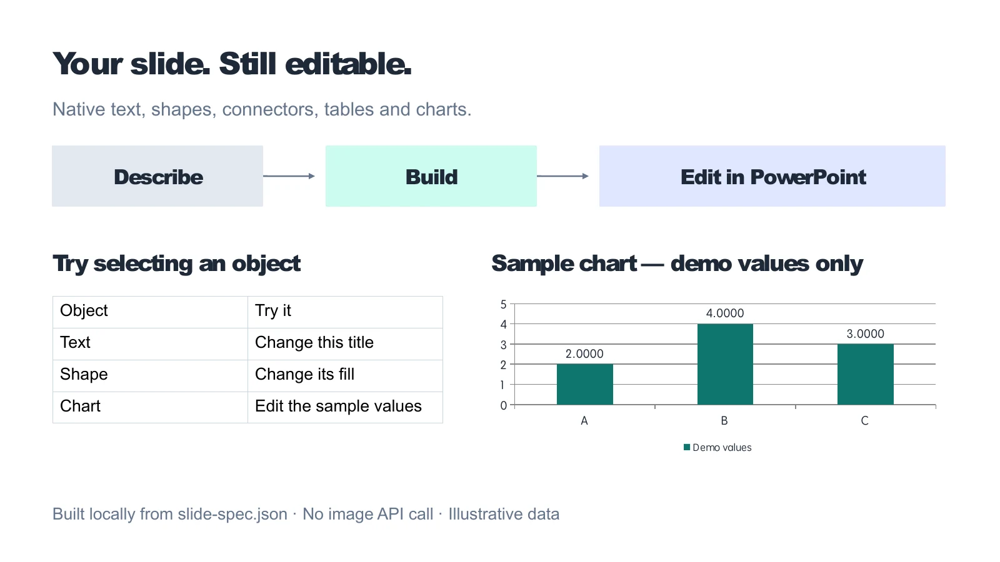

# PaperBanana Skills

> 当前为预览分支：marketplace 4.6.0、插图插件 4.5.0、演示插件 1.4.0；v4.5 正式版仍是稳定基线。[原生/API 路由说明](references/image-routing.md)：原生生图无需 Python 后端。

**让你的智能体生成学术插图，编排幻灯片，交付可编辑的 PowerPoint。**

[](https://github.com/PlutoLei/paperbanana-skill/releases)
[](https://github.com/PlutoLei/paperbanana-skill/actions/workflows/validate.yml)
[](LICENSE)

[English](README.md) · **中文**

[快速开始](#快速开始) · [下载可编辑 PPTX](examples/editable-demo/research-brief/research-brief.pptx) · [精选案例](#精选案例) · [文档导航](#文档导航)

把方法描述变成科研图，编排风格一致的图片式幻灯片，或生成可继续修改的 PowerPoint 对象。在 **Codex 或 Claude Code** 中使用。

<p align="center">
<a href="docs/gallery.md#academic-figures--学术插图"></a>
<a href="docs/gallery.md#slide-deck"></a>
<a href="examples/editable-demo/research-brief/README.md"></a>
</p>

<p align="center"><strong>科研图 · 图片式幻灯片 · 可编辑 PowerPoint</strong></p>

*前两张为历史产出，第三张由本地渲染器生成，使用合成演示数据。[来源与完整案例 →](docs/gallery.md)*

## 快速开始

### 1. 选择产出

| 产出 | 所需环境 |
| --- | --- |
| **科研图** | `paperbanana` + [Python 后端](docs/getting-started.md#python-后端)，配置生图和评审提供商 |
| **图片式幻灯片** | `paperbanana-slide-deck` + 同一后端；每页作为完整图片交付 |
| **可编辑 PowerPoint** | `paperbanana-slide-deck` + Bun；可直接[构建随附示例](examples/editable-demo/research-brief/README.md#中文说明)，不调用生图 API |

### 2. 按运行环境安装

**Codex**：从完整目录安装插图技能。

```bash
npx skills add https://github.com/PlutoLei/paperbanana-skill/tree/master/plugins/paperbanana/skills/paperbanana -a codex
```

制作任一种幻灯片时，另外安装[演示技能](docs/getting-started.md#codex)。安装技能不会自动安装 Bun、配置生图访问或安装 Python 后端。

**Claude Code**：添加市场后，选择所需的[插图或演示插件](docs/getting-started.md#claude-code)。

```bash
claude plugin marketplace add PlutoLei/paperbanana-skill
```

### 3. 描述任务

> 用 paperbanana 和 Gemini 画一个带批量归一化的四层 CNN，标清输入、卷积模块和分类器，返回图片及其评审状态。

需要修改 PowerPoint 中的文字、表格和图表时，明确要求**原生可编辑 PPTX**；需要整页生成图时，明确选择**图片模式**。已有提供商偏好时，请直接写明。[更多起步提示词 →](docs/prompts.md)

已有 Gemini / Vertex 配置可以继续使用。**预览功能：** Codex 原生生图路由与 Image 2.5 控制仍位于 [`codex/image25-adapter`](https://github.com/PlutoLei/paperbanana-skill/tree/codex/image25-adapter)，尚未进入当前 v4.5 正式版。[提供商分工与预览说明 →](docs/providers.md#中文说明)

## 精选案例

<table>
<tr>
<td width="50%" valign="top"><strong>科研图</strong><br/><a href="examples/game_theory_influence_diagram.png"></a><br/>历史 Gemini 产出 · <a href="docs/prompts.md#scientific-figure">起步提示词</a></td>
<td width="50%" valign="top"><strong>图片式幻灯片</strong><br/><a href="docs/gallery.md#slide-deck"></a><br/><a href="docs/gallery.md#slide-deck">查看整组</a> · <a href="docs/prompts.md#consistent-deck">起步提示词</a></td>
</tr>
<tr>
<td width="50%" valign="top"><strong>可编辑研究汇报</strong><br/><a href="examples/editable-demo/research-brief/README.md"></a><br/>3 页 · 合成数据 · <a href="examples/editable-demo/research-brief/research-brief.pptx">下载 PPTX</a> · <a href="examples/editable-demo/research-brief/slide-spec.json">源文件</a></td>
<td width="50%" valign="top"><strong>最小可编辑示例</strong><br/><a href="examples/editable-demo/README.md"></a><br/>1 页 · <a href="examples/editable-demo/editable-demo.pptx">下载 PPTX</a> · <a href="examples/editable-demo/slide-spec.json">源文件</a></td>
</tr>
</table>

历史图片保留来源限制；两份 PPTX 都可在本地重建，数值只用于演示编辑能力，不是研究结果。起步提示词是新编写的任务模板，并非历史生成时的原始输入。[完整图库 →](docs/gallery.md)

## 工作方式

- **`paperbanana`** 负责理解插图、图表和幻灯片需求，调用已配置的 Python 流水线完成检索、规划、风格设计、生图和 Critic 评审。
- **`paperbanana-slide-deck`** 负责整套演示的内容与风格编排。开始时明确选择图片模式或原生可编辑 PPTX 模式。
- **[Python 后端](https://github.com/PlutoLei/paperbanana)** 提供模型接入与生成、评审流程；本地可编辑 PPTX 渲染器则直接包含在技能仓库中。

运行环境、生图提供商、评审提供商各有分工。接入了某个 VLM，并不代表它也能生成图片。[提供商、运行环境与路由 →](docs/providers.md#中文说明)

## 验证与限制

CI 检查技能文件、插件清单和 PPTX 渲染器。[可编辑研究汇报](examples/editable-demo/research-brief/README.md#中文说明)同时提供源文件和原生对象。预览已在本地渲染后检查，但不代表所有 PowerPoint 版本显示完全一致。用于论文前，仍须核对标签、箭头、数值和科学表述；Critic 的自动评分不能替代科学审查。

生成结果可能出现文字或结构错误，评审失败时应明确标记为**未评审**。历史对比和最近的冒烟测试不代表通用模型排名，也不能承诺固定耗时或费用。[证据与质量检查 →](docs/evaluation.md#中文说明)

## 文档导航

| 文档 | 用途 |
| --- | --- |
| [安装与上手](docs/getting-started.md#中文说明) | 安装技能、配置后端、生成首个结果 |
| [完整图库](docs/gallery.md) · [起步提示词](docs/prompts.md) | 查看原图、了解来源、改写自己的任务 |
| [提供商说明](docs/providers.md#中文说明) | Claude Code / Codex、Gemini / Vertex、OpenAI 与预览功能 |
| [风格库](docs/styles.md#中文说明) | 随仓库提供的风格、可选来源与后端预设 |
| [可编辑 PPTX 示例](examples/editable-demo/research-brief/README.md#中文说明) · [对象规范](plugins/paperbanana-slide-deck/references/editable-slide-spec.md) | 构建和修改原生 PowerPoint 对象 |
| [命令与排障](docs/usage.md#中文说明) | 常用命令、故障恢复与评审状态 |
| [评测说明](docs/evaluation.md#中文说明) | 证据、质量检查及局限 |
| [更新日志](CHANGELOG.md) · [正式版本](https://github.com/PlutoLei/paperbanana-skill/releases) | 查询版本变化 |

当前正式版组件：技能市场 **4.5.0**、`paperbanana` 插件 **4.4.0**、`paperbanana-slide-deck` 插件 **1.3.0**。三者分别维护版本号。

## 贡献与致谢

参与前请阅读[贡献指南](CONTRIBUTING.md)和[行为准则](CODE_OF_CONDUCT.md)。报告问题时，请附运行环境、提供商与模型名称，以及可复现步骤。

本项目基于 [PaperBanana](https://github.com/llmsresearch/paperbanana)，附加集成由[维护版 Python 后端](https://github.com/PlutoLei/paperbanana)提供。风格来源见[风格库说明](docs/styles.md)。

[MIT 许可证](LICENSE) · 维护者：[雷宇轩 / Lei Yuxuan](https://github.com/PlutoLei)。
