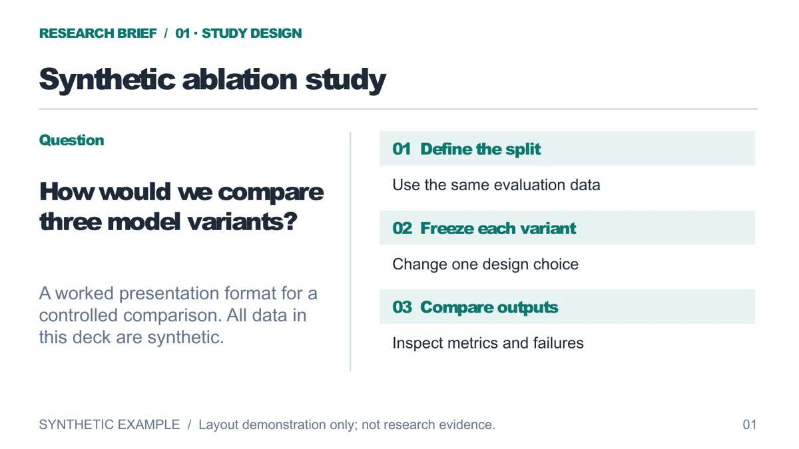
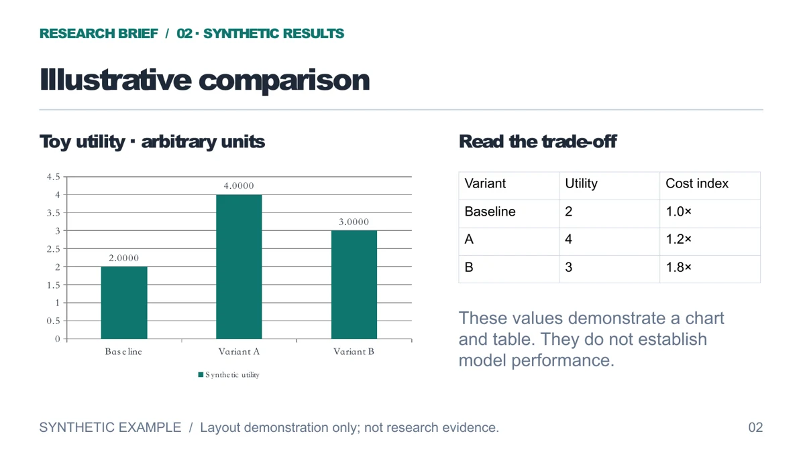
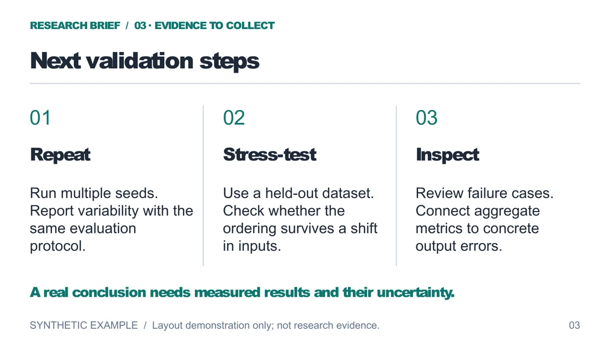

# Editable research brief

[Home](../../../README.md) · [Download the three-slide PPTX](research-brief.pptx) · [Source spec](slide-spec.json) · [中文说明](#中文说明)

A three-slide example of a research presentation: study design, a synthetic comparison, and the evidence a real study would still need. **All model names, values and relative costs are arbitrary demonstration data. No model was trained or evaluated.**

| Study design | Synthetic comparison | Next validation steps |
| --- | --- | --- |
| [](../../previews/research-brief-01.webp) | [](../../previews/research-brief-02.webp) | [](../../previews/research-brief-03.webp) |

The deck uses native PowerPoint text, shapes, lines, a table and a chart. It contains no full-slide images and requires no image API call. The [single-slide object demo](../README.md) remains available for a smaller example.

## Rebuild

From the repository root:

```bash
cd plugins/paperbanana-slide-deck
bun install --frozen-lockfile
bun scripts/build-deck.ts --mode editable ../../examples/editable-demo/research-brief \
  --output ../../examples/editable-demo/research-brief/research-brief.pptx
```

Edit `slide-spec.json` and rebuild to change the content. The deck is generated by this repository's renderer with PptxGenJS 4.0.1. Previews were rendered through LibreOffice and Poppler, then encoded as WebP. [The preview manifest](preview-manifest.json) records the spec, PPTX and preview hashes.

## Try the objects

Open the downloaded deck in PowerPoint. Change a heading, select one of the study-design shapes, edit a table cell, and use the chart's **Edit Data** action. The preview shows appearance; the PPTX contains the objects to inspect. Automated package inspection and LibreOffice rendering do not establish that every PowerPoint version renders identically.

The values 2, 4 and 3 are synthetic utilities in arbitrary units. Cost indices 1.0×, 1.2× and 1.8× are also invented. The deck demonstrates a presentation structure, not a scientific finding or a model comparison result.

## 中文说明

这套三页示例依次展示研究设计、合成数据比较和下一步验证。**模型名称、数值和相对成本均为演示内容，没有运行训练或模型评测。**

下载 PPTX 后，可以修改标题、选中流程形状、编辑表格单元格，并打开图表的“编辑数据”。它们都是原生 PowerPoint 对象；预览图只用于展示外观，不能单独证明可编辑性。

需要重建时，在仓库根目录执行上方命令。修改 `slide-spec.json` 后重新构建，不直接修改预览图。生成过程使用仓库渲染器，不调用图片 API。[单页对象示例](../README.md#中文说明)适合检查最小构建流程。

图中的 2、4、3 是任意单位的合成效用值；1.0×、1.2×、1.8× 也是虚构的相对成本。它们不能用于研究结论。PPTX 结构检查和 LibreOffice 渲染不代表已验证所有 PowerPoint 版本的显示效果。
